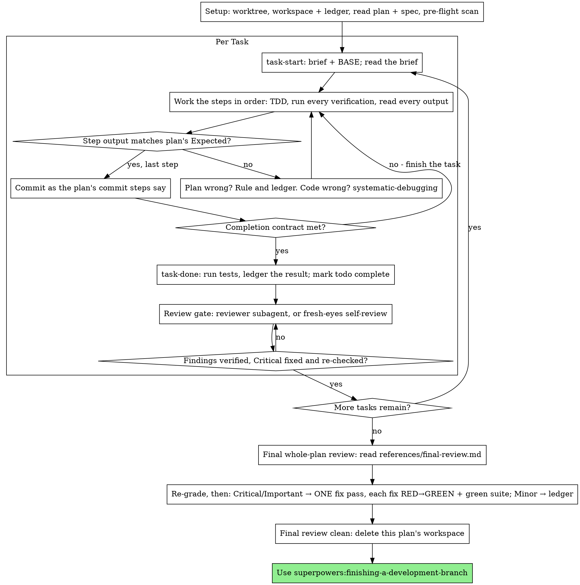

# Executing Plans

Execute the plan yourself, task by task, in this session: no implementer
subagent per task. Every task still gets a review gate — a dispatched
reviewer subagent when the harness has one, a fresh-eyes self-review when
it does not — and one final whole-plan review of the entire branch
closes the run.

**Why inline:** Subagent-driven development pays for a fresh implementer
and a fresh reviewer on every task, each re-reading the codebase from
zero. Inline execution pays for one context (yours) plus a reviewer on
every task. What it gives up is a fresh implementer context per task.
This skill keeps what that bought, by other means: the brief is the spec,
the ledger is your memory, TDD is the per-task gate, the per-task review
is the second pair of eyes, and the final whole-plan review is the pass
that sees the branch as one change.

**Core principle:** The plan already did the thinking. Execute it exactly,
prove each step with a test you watched fail and then pass, and leave a
record that survives your own forgetting.

**Narration:** between tool calls, narrate at most one short line — the
ledger and the tool results carry the record.

**Continuous execution:** Do not pause to check in with your human partner
between tasks. This plan runs inline to spend less, not to answer
"should I continue?" after every task. Execute all tasks from the plan
without stopping — the per-task review gate is not a check-in; it runs
on the diff, not on your partner's patience.

**Rulings, not stalls.** Conflicts, ambiguities, plan defects — decide them.
The spec is the binding authority, the plan is its argument, and your
judgment settles what neither answers. Record every decision in the ledger
as `Ruling: <what you decided> — <why> — <what it costs if wrong>`, and keep
going. Deviating from the plan without a ledgered ruling is a decision made
in secret.

Five things stop you, and only these: an irreversible or destructive
operation; a security-sensitive action; a side effect outside this worktree
that norms say you ask about first (a merge, a push to a shared branch, a
publish); a task-review or final-review finding that invalidates the plan's
approach; and a plan so broken that every path forward is a guess. For
those, stop and ask.

## When to Use

- Your harness has no subagent tool (see the per-platform references in
  `../using-superpowers/references/`). Never fabricate a dispatch; run
  the plan here. The per-task review gate runs as a fresh-eyes
  self-review in this case.
- You've fallen back to this skill because the harness has no subagent
  tool: the superpowers:writing-plans handoff routes here only as that
  fallback, never as a choice. If a subagent tool does exist in this
  harness, the per-task review gate dispatches a fresh reviewer subagent
  instead of self-reviewing.
- Tasks are mostly independent — the same precondition as
  superpowers:subagent-driven-development.

A fully specified plan makes inline execution transcription plus testing:
it runs well on a mid-tier session model, and the one place the most
capable model earns its cost is the final review, which this skill
dispatches separately. Tell your human partner so when this fallback
runs.

Prefer superpowers:subagent-driven-development when subagents are
available: it buys a fresh implementer context per task as well as a
fresh reviewer. Inline execution over a long plan still works — the
ledger is what makes it recoverable — but the last tasks get the least
of you.

## The Process

## Setup

Ensure the work happens in an isolated workspace: use
superpowers:using-git-worktrees to create one or verify the existing one.
Never start implementation on a main/master branch without your human
partner's explicit consent.

Conversation memory does not survive compaction. An inline executor that
loses its place re-implements tasks whose commits already exist — the same
failure as a controller re-dispatching them, paid for in your own context.
Track progress in a ledger file, not only in todos. Harness todos are a
live view; the ledger is the record.

The workspace and ledger are shared with superpowers:subagent-driven-development
— same directory, same format — so a plan can change executors mid-flight
and the new one resumes from the same ledger.

- Each plan owns a workspace: at skill start, run
  `bash skills/subagent-driven-development/scripts/sdd-workspace PLAN_FILE`
  — it prints the plan's scratch directory
  (`/tmp/superpowers/<project-id>/sdd/<plan-basename>/`, where
  `<project-id>` is the repo root's basename plus the first 6 hex chars of
  the root path's md5), home to every artifact for THIS plan: ledger,
  briefs, review packages. Another plan's directory is never yours to
  read or write.
- The workspace lives outside the repository, under /tmp: it never
  dirties `git status`, never lands in a commit, and survives
  `git clean -fdx`. But /tmp is ephemeral — if the workspace is lost,
  recover from `git log`.
- Check for this plan's ledger at `<workspace>/progress.md`. If its first
  line names your plan file, tasks with a `Task <N>: complete` line are
  DONE — do not redo them; resume at the first task without one. Their
  commits exist in git even when your context no longer remembers making
  them: after compaction, trust the ledger and `git log` over your own
  recollection. A ledger whose first line names a different plan file is
  another plan's progress: leave it and start your own, fresh.
- Create the ledger with its identity as the first line:
  `# SDD ledger — plan: <plan file path>`.

Read the plan once, note its context and Global Constraints, and create a
todo per task. If the plan names a Spec, read that too: the spec is the
authority the plan argues from, and conflicts inside the plan resolve
against it. A plan with no reachable spec gets a ledger note saying so —
rulings made without one are provisional.

**REQUIRED SUB-SKILL:** load superpowers:test-driven-development now,
before Task 1. It governs every step of every task below; a plan whose
steps already say "write the failing test first" does not exempt you
from reading it.

Before Task 1, scan the plan for conflicts between tasks. The plan's
Interfaces blocks tell you where to look: for every task that consumes
what an earlier task produces, one ledger row — the two tasks, what one
produces against what the other consumes, and what you found. Tasks that
share nothing get no row; a plan whose tasks share nothing gets the single
line `Pre-flight: no shared interfaces`. Rule on each conflict a row
surfaces with the spec as the binding authority, record the ruling beside
its row, and start Task 1. Each task's own text is checked when you read
its brief, not here.

## The Task Loop

Everything you print, and every tool result, stays resident in your
context for the rest of the session. Redirect long test output to a file
in the workspace and read its tail; read a brief, not the whole plan.

### 1. Take the task

- Run `bash skills/executing-plans/scripts/task-start PLAN_FILE N`. It
  prints the brief path and BASE (the commit the task's range is cut
  from) in one call. Read the brief for every task, including ones you
  remember from setup: what you remember is a summary, the brief has
  the exact values, signatures, and test cases.
- Mark the task's todo in_progress.

Every tool call is a turn that re-reads your whole context. Bookkeeping
rides along with work — a ledger append in the same call as the commit,
never in a call of its own.

### 2. Work the steps

The plan's steps are already in RED-GREEN order; follow them in that
order under superpowers:test-driven-development, loaded at setup. A test
step's code is written first and run first. Watching it fail is a step,
not a formality — a test that passes before the implementation exists is
a finding about the test.

Every step that runs a command has an `Expected:` line. Run the command,
read its output, and compare. Three outcomes:

- **Matches.** Next step.
- **The code is wrong.** Use superpowers:systematic-debugging. Find the
  cause; never patch the symptom to make the step's output match.
- **The plan is wrong** — a step contradicts the spec, an interface from
  an earlier task doesn't match what this task consumes, a command that
  cannot work. Rule on the smallest change that satisfies the spec, ledger
  it as `Task <N>: Ruling: <finding> — <what you decided and why>`, and
  continue. The ruling is carried, not remembered: later tasks that touch
  the same interface read it from the ledger.

Commit as the plan's commit steps say. A task that spans several commits
is fine; BASE is what the review range is cut from, never `HEAD~1`.

### 3. The completion contract

Before a task's ledger line, all of the following are true, with evidence
in this session — not inferred from the diff looking right:

- Every test the brief names exists and ran in this task, and you read
  the output.
- The final test run for the task passed — `task-done` is that run, and
  it writes the command and result into the ledger line.
- Every `Expected:` line in the brief was compared against real output.
- Every deviation from the brief has a `Ruling:` line in the ledger.

**REQUIRED SUB-SKILL:** superpowers:verification-before-completion governs
the claim. If any item is missing, the task is not complete: finish it.

### 4. Complete the task

Run `bash skills/executing-plans/scripts/task-done PLAN_FILE N BASE -- <test command>`
with the test command the brief names for the whole task. It runs the
tests, keeps the full output in the workspace, prints the tail, and — only
if they pass — appends the completion line to the ledger:

`Task <N>: complete (commits <base7>..<head7>, tests: <command> → <result>)`

A failing run records nothing; the task is not complete. When it records,
mark the todo complete — and take the review gate before the next task.

### 5. Review the task (every task)

Completed is not verified. You just implemented this task, which makes
you the worst reviewer of it — every task gets independent eyes before
the next one starts.

Build the review package with the range task-start gave you:
`bash skills/subagent-driven-development/scripts/review-package PLAN_FILE BASE HEAD`
(BASE is the commit task-start printed for this task — never `HEAD~1`,
which silently drops all but the last commit of a multi-commit task).

**With a subagent tool:** dispatch a fresh reviewer subagent using
superpowers:requesting-code-review's
[code-reviewer.md](../requesting-code-review/code-reviewer.md), with the
package path, the brief path, and a pointer to the ledger's `Ruling:`
lines so it can weigh the calls you made. The reviewer template re-runs
risk diffs (write paths, auth/secrets/permissions, concurrency,
plan-named risks) at HEAD — your earlier runs do not transfer. For
everything else it demands command-and-output evidence; carry the task's
verification command and output into the dispatch. Prose verdicts come
back as findings.

**Without a subagent tool:** step away, then re-read. A fresh-eyes
self-review re-reads the task's diff line by line against the brief —
implementation matches the brief, the verification commands actually ran
and passed, nothing extra slipped in — and re-runs the verification
commands: reading is not verifying. For non-risk diffs, the evidence
floor is the command and its output, written down as it ran, not from
memory. Ledger `Task <N>: self-review (no subagent tool)`, and say so in
your final message: a self-review by the author is weaker than a fresh
reviewer, and your human partner decides whether that is enough.

**REQUIRED SUB-SKILL:** superpowers:receiving-code-review governs every
finding. Verify each one is real before acting on it — reproduce the
problem; don't perform agreement.

- **Critical findings:** fix them (TDD — a test that failed first), commit,
  and have the reviewer re-check the fix.
- **Non-critical findings:** record them in the ledger for the final
  whole-plan review.

Findings gate the next task: do not start Task N+1 while this task's
review has open Critical findings. A finding that invalidates the plan's
approach is a stop — surface it to your human partner.

## Final Review and Finish

When every task is complete and reviewed, read
[references/final-review.md](references/final-review.md) and follow it. It
covers the whole-plan review, its single fix pass, and how you finish.

## Common Rationalizations

| Excuse | Reality |
|--------|---------|
| "I remember what Task N says" | You remember a summary. The brief has the exact values. Read it. |
| "The plan's code is right, skip watching the test fail" | A test you never saw fail proves nothing. It is one step. Run it. |
| "I'll run the full suite at the end instead of per step" | Per-step runs are how you learn which step broke it. The end-of-task run is the contract, not a substitute. |
| "The plan is wrong here, I'll just do the right thing" | Do the right thing and ledger the ruling. Unledgered deviation is a decision made in secret. |
| "I'll write the ledger lines after a few tasks" | Compaction does not wait for a convenient moment. One line per task, in the same message as the commit. |
| "Let me check in before the next task" | Inline is the spend-less fallback. Progress prompts spend their time instead. Only the five stops stop you. |
| "The task went green, the per-task review can wait" | Completed is not verified. The review gate runs after every task, before the next one starts. |
| "I read my own diff carefully; the reviewer is redundant" | Same author, same blind spots. The reviewer is the fresh context every task buys. |
| "Tests should pass, the change was trivial" | "Should" is not evidence. The contract requires the command and its output. |
| "Every task was reviewed; I'll skip the final review" | Task reviews cover their own ranges. Only the whole-plan review sees cross-task effects. It is the floor, not the ceiling. |
| "The reviewer said Minor, so it's Minor" | The label graded the spec's silence. Grade what the person gets. Re-grade, then gate. |
| "The fix is obvious, no need for a failing test first" | The failing test is the only proof the finding was real and is now gone. Without it you have a diff and a hope. |
| "I'll fix the minors too while I'm in there" | Every minor you fix is a test, a fix, and a suite run your partner did not ask for. Ledger them; your partner decides. |
